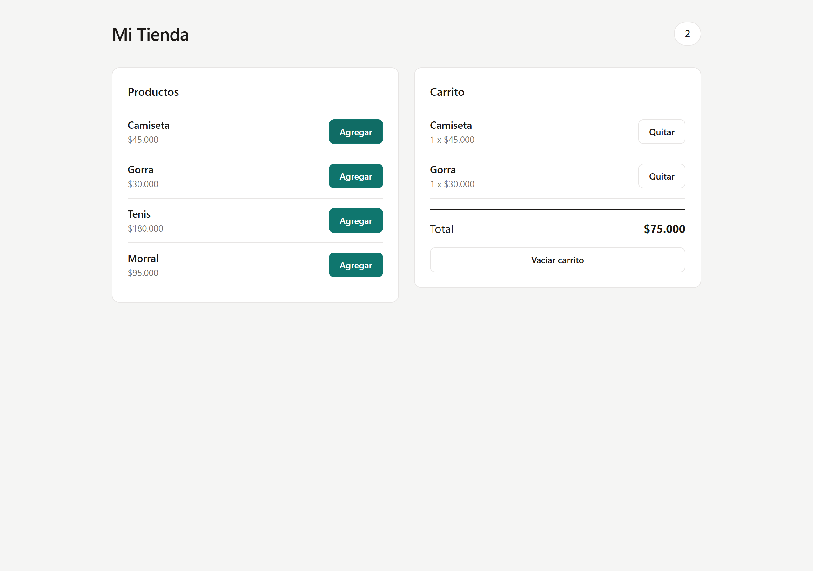
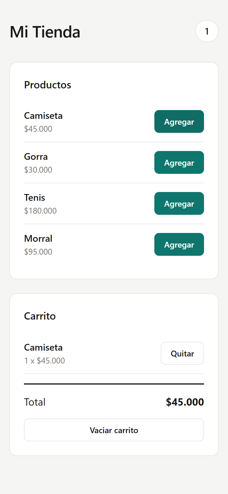

# Carrito de compras con React y Zustand

Tienda de ejemplo con un carrito de compras cuyo estado se comparte entre
componentes mediante **Zustand**, sin pasar props ni usar `Provider`.

Proyecto desarrollado a partir de la guía práctica **“Carrito de compras con
React y Zustand”** (SENA, instructor Juan Pablo Chamizzo Vega).



## Tecnologías

- React 19
- Vite 8
- Zustand 5
- CSS puro con variables

## Funcionalidades

- Catálogo de productos con nombre y precio en formato de pesos colombianos.
- Agregar productos al carrito.
- Si un producto se agrega de nuevo, aumenta su cantidad en lugar de duplicar
  la fila.
- Contador de unidades en el encabezado, sincronizado con el store.
- Cálculo automático del total a pagar.
- Quitar un producto específico.
- Vaciar el carrito completo.
- Diseño responsive: dos columnas en escritorio y una en móvil.

## Estructura del proyecto

```text
carrito-zustand/
├── docs/
│   ├── captura-tienda.png
│   └── captura-movil.png
├── src/
│   ├── data/
│   │   └── productos.js          # datos de la tienda
│   ├── store/
│   │   └── useCarritoStore.js    # estado global (Zustand)
│   ├── components/
│   │   ├── Encabezado.jsx        # título y contador
│   │   ├── ListaProductos.jsx    # catálogo
│   │   └── Carrito.jsx           # carrito y total
│   ├── App.jsx                   # une los componentes
│   ├── index.css                 # estilos de la app
│   └── main.jsx                  # punto de entrada
├── index.html
├── package.json
└── README.md
```

La separación de responsabilidades es la siguiente: `data` guarda la
información, `store` concentra el estado y la lógica, y `components` contiene la
parte visual.

## Cómo ejecutar el proyecto

Requisitos: Node.js 20.19+ o 22.12+ (el proyecto se creó con Node 26) y npm.

```bash
# Entrar a la carpeta del proyecto
cd carrito-zustand

# Instalar dependencias
npm install

# Iniciar el servidor de desarrollo
npm run dev
```

Abre la dirección que muestra la terminal (normalmente
`http://localhost:5173`).

Otros comandos disponibles:

```bash
npm run build     # compila para producción
npm run preview   # sirve la compilación de producción
npm run lint      # analiza el código con oxlint
```

## Comprobación de la guía

Todas las pruebas se ejecutaron en el navegador con Playwright y Chrome:

- [x] Al cargar, el carrito dice “Tu carrito está vacío” y la insignia muestra 0.
- [x] Al agregar una Camiseta, aparece en el carrito y la insignia sube a 1.
- [x] Al agregar otra Camiseta, no se duplica la fila: la cantidad pasa a 2.
- [x] El total se recalcula con cada producto agregado.
- [x] El botón **Quitar** elimina solo ese producto.
- [x] El botón **Vaciar carrito** deja la insignia en 0 y muestra el mensaje de vacío.
- [x] En una pantalla angosta, los dos paneles se ubican uno debajo del otro.
- [x] Sin errores en la consola del navegador.

Resultado: **19/19 comprobaciones correctas**.

Vista móvil:



## Preguntas de reflexión

### 1. ¿Por qué Encabezado se actualiza cuando agregas un producto, si no recibe ninguna prop?

Porque `Encabezado` no depende de sus props, sino de una suscripción directa al
store. Al ejecutar:

```js
const items = useCarritoStore((state) => state.items)
```

el componente queda suscrito a `items`. Cuando una acción del store cambia ese
valor, Zustand avisa a todos los componentes suscritos y React vuelve a
renderizar `Encabezado`, sin que `App` tenga que pasarle nada. Esa es
precisamente la ventaja del estado global: el dato se lee donde se necesita, sin
“prop drilling”.

### 2. ¿Qué tendrías que hacer para lograr lo mismo usando solo useState en App?

Tendría que **elevar el estado** al ancestro común y repartirlo por props:

```js
function App() {
  const [items, setItems] = useState([])

  const agregarProducto = (producto) => { /* ... */ }
  const eliminarProducto = (id) => { /* ... */ }
  const vaciarCarrito = () => setItems([])

  return (
    <>
      <Encabezado items={items} />
      <ListaProductos agregarProducto={agregarProducto} />
      <Carrito
        items={items}
        eliminarProducto={eliminarProducto}
        vaciarCarrito={vaciarCarrito}
      />
    </>
  )
}
```

Cada componente recibiría los datos y las funciones como props. Funcionaría,
pero `App` se vuelve el dueño de toda la lógica, hay que pasar props por niveles
intermedios y cualquier cambio en `items` vuelve a renderizar `App` y su árbol.
Otra alternativa sería `Context API`, que evita el paso manual de props, pero
exige crear un `Provider` y envolver la aplicación.

### 3. ¿Para qué sirve el selector `(state) => state.items` al usar el hook?

Sirve para **suscribirse solo a una parte del estado**. El componente se vuelve
a renderizar únicamente cuando cambia el valor seleccionado; los cambios en
otras propiedades del store no lo afectan. Por ejemplo, `ListaProductos` solo
selecciona `agregarProducto`, que es una referencia estable, así que no se
redibuja cuando cambia el carrito. Esto mejora el rendimiento y hace explícita
la dependencia de cada componente.

### 4. ¿Por qué en el store se crean arreglos nuevos con `map` y `filter` en lugar de modificar `items` directamente?

Porque el estado debe tratarse como **inmutable**. React y Zustand detectan los
cambios comparando referencias: si se hace `items.push(...)` o se asigna
`item.cantidad = 2`, el arreglo conserva la misma referencia y es posible que la
interfaz no se actualice. `map`, `filter` y el operador spread crean un arreglo
nuevo (y objetos nuevos cuando corresponde), de modo que el cambio se detecta de
forma confiable. Además se evitan efectos secundarios y se conserva un historial
de estados predecible, lo que facilita depurar.

### 5. ¿Zustand es parte de React? Explica la diferencia entre una librería propia de React y una del ecosistema.

No. React es la librería base: proporciona el modelo de componentes, el
renderizado y hooks como `useState` y `useEffect`. Zustand es una librería
**externa del ecosistema**, se instala aparte con `npm install zustand` y tiene
su propio versionado y mantenimiento. Está diseñada para trabajar con React
(también tiene una versión “vanilla” para JavaScript), pero no forma parte del
paquete `react`. Se puede reemplazar por otra solución de estado (Redux, Jotai,
Context API) sin cambiar el hecho de que React sigue siendo el framework de
interfaz. Una librería “propia de React” sería algo incluido y mantenido por el
equipo de React; una “del ecosistema” es una pieza de terceros que lo extiende.

## Retos de extensión

La guía propone cuatro retos opcionales: disminuir cantidad, mostrar el subtotal
por producto, persistir el carrito con el middleware `persist` y cargar los
productos desde `fakestoreapi.com`. Esta entrega implementa la actividad base
completa; los retos quedan como siguiente paso.

## Créditos

Guía original: *Guía práctica: Carrito de compras con React y Zustand*, SENA
2026, instructor Juan Pablo Chamizzo Vega.
